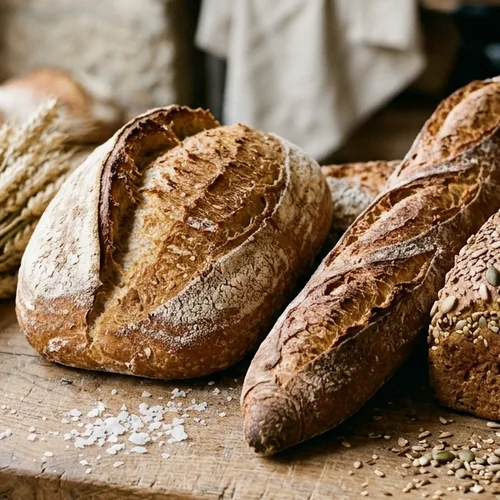

# Bakerz Bite — Complete Artisan Bakery & Patisserie Website

**Bakerz Bite** is an artisan bakery and cafe website built using **HTML5, CSS3, Modern Vanilla JavaScript, and Bootstrap 5**. It stores cart, wishlist, custom cake builds, and store settings in client-side `localStorage`. Standard styles and typography use modern CDN distribution (Bootstrap 5 and Google Fonts).

---

## 🎨 Visual Design System & Palette

- **Strawberry Pink (`#F5A6C5`)**: Primary brand color & hero highlights.
- **Butter Yellow (`#FFE5A0`)**: Accents, tickers, and button secondary actions.
- **Pistachio Green (`#BCE2C1`)**: Fresh savory tags & coupon banners.
- **Lavender Milk (`#DCC7F5`)**: Delicate pastry tags & decorative borders.
- **Cream (`#FFF8EC`)**: Warm, comforting primary page canvas background.
- **Cherry Red (`#E85D68`)**: Primary CTA buttons & prominent price highlights.
- **Chocolate Brown (`#553A36`)**: Readable, high-contrast typography and borders.

### Typography
- **Fredoka**: Expressive display headlines and brand marks.
- **Baloo 2**: Playful secondary headings and category markers.
- **Nunito**: Crisp, accessible body prose and form interfaces.

---

## 📁 File Structure

```text
bakerz-bite/
├── index.html           # Complete homepage with Cake Studio teaser
├── cake-studio.html     # Full interactive custom cake designer
├── menu.html            # Complete bakery catalog with filtering & search
├── about.html           # Brand story, sourdough philosophy & master bakers
├── gallery.html         # Interactive photo gallery with fullscreen lightbox
├── offers.html          # Curated bundles, promo coupons & discount vouchers
├── contact.html         # Validated contact form, store hours & map placeholder
├── faq.html             # Categorized, searchable frequently asked questions
├── sitemap.html         # Complete website navigation directory
├── login.html           # Demo customer login with password reveal toggle
├── signup.html          # Demo customer registration (100 welcome points)
├── cart.html            # Dedicated shopping basket with promo voucher logic
├── checkout.html        # Demo order placement with order ID confirmation
├── dashboard.html       # Customer portal: orders, saved cakes & loyalty tier
├── admin-demo.html      # Store admin portal: sales analytics & inventory
├── 404.html             # Custom branded 404 error page
│
├── assets/
│   └── images/
│       ├── bakerz-bite-logo.png  # Primary high-res 3D clay logo
│       ├── products/             # Dedicated product image folder
│       ├── categories/           # Category cards folder
│       ├── gallery/              # Gallery photos folder
│       └── hero/                 # Hero promotional artwork folder
│
├── css/
│   ├── style.css        # Global variables, clay buttons, cards & navbar
│   ├── animations.css   # Keyframe animations, marquee & floating stickers
│   ├── pages.css        # Cake Studio visual layers, lightbox & dashboards
│   └── responsive.css   # Mobile offcanvas drawer & responsive breakpoints
│
└── js/
    ├── products.js      # Complete catalog data in PKR with allergen info
    ├── cart.js          # Cart state in localStorage & sliding drawer
    ├── wishlist.js      # Saved wishlist in localStorage & live badges
    ├── filters.js       # Live search, category tabs, price slider & quick view
    ├── cake-studio.js   # Interactive 3D visual cake preview & price math
    ├── gallery.js       # Masonry grid, keyboard lightbox & filters
    ├── forms.js         # Validation, password toggles & toast alerts
    ├── dashboard.js     # User profile, demo orders & admin charts
    ├── bg-video.js      # Homepage hero background video with reduced-motion fallback
    └── main.js          # Live clock, scroll progress & product card tilt
```

---

## 🖼️ How to Add Your Real Images

Every image container in the source code is marked with an explicit HTML comment and consistent file paths:

### 1. Logo
The primary logo is located at:
`assets/images/bakerz-bite-logo.png`
To update the logo, simply replace this PNG file with your new logo image.

### 2. Product Images
In HTML files and JavaScript, search for comments structured like:
```html
<!-- PRODUCT IMAGE PLACEHOLDER: add product image here (assets/images/products/white-bread.webp) -->
```
Drop your photograph into `assets/images/products/` with the filename specified in the comment (e.g. `white-bread.webp`, `chocolate-cake.webp`, `butter-croissant.webp`). Then update the CSS background or replace the placeholder container with an standard `` tag:
```html

```

### 3. Gallery Images
In `gallery.html` and `js/gallery.js`, add your photography to `assets/images/gallery/` matching the items in `js/gallery.js`.

---

## 🚀 How to Run the Website

### Instant Run (Zero Build Required)
This project is built with clean **HTML5, CSS3, Modern Vanilla JavaScript, and Bootstrap 5**. All logic is written in native ES6+ without unnecessary legacy libraries like jQuery, and all state persistence is managed in `localStorage`.

1. Simply open `index.html` directly in any modern browser (Google Chrome, Microsoft Edge, Mozilla Firefox, or Apple Safari).
2. Every page, menu filter, cart drawer, wishlist, custom cake visualizer, and gallery lightbox works immediately out of the box!

*(Optional: You can also serve it from any local HTTP static server, e.g. `python -m http.server`).*

---

## 🎂 Key Interactive Features

1. **Live Clock & Flagship Store Location**: Dynamic header clock updating every second and centralized store location (`Main Boulevard, North Nazimabad, Karachi`).
2. **Real-Time Visitor Counter**: Tracks page impressions in `localStorage`.
3. **Interactive Cake Studio**: Choose size, flavors, frosting types, pastel colors, toppings, and custom piped message with live 3D visual preview.
4. **Sliding Cart Drawer & Wishlist**: Real-time state preservation in `localStorage` across page navigation.
5. **Interactive Filter & Search**: Instant client-side filtering by category, text query, and price range.
6. **Toast Notification System**: Instant feedback for add to cart, coupon applied, and wishlist toggled.
